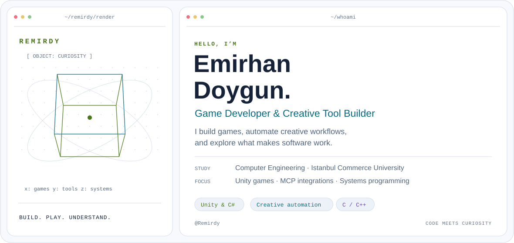
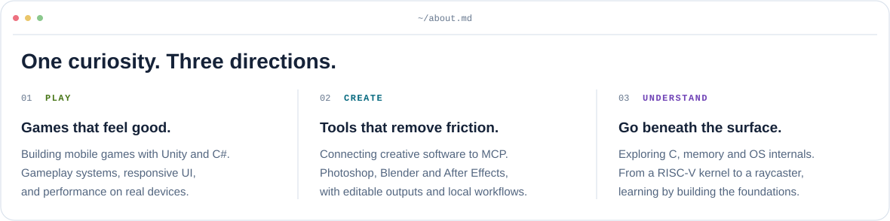
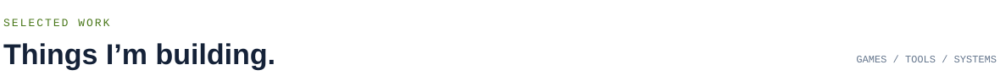
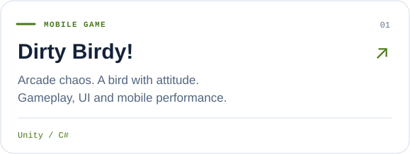
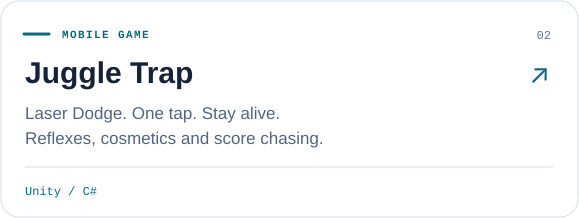
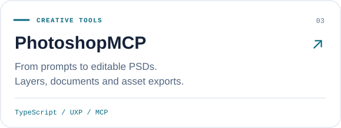
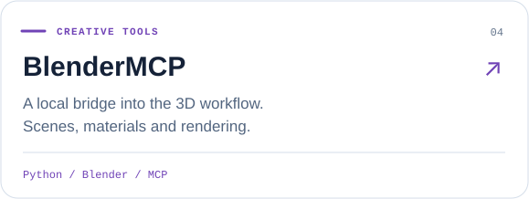
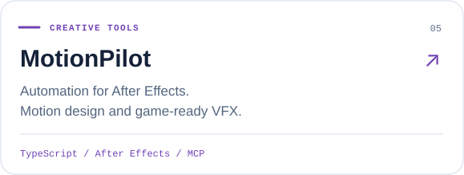
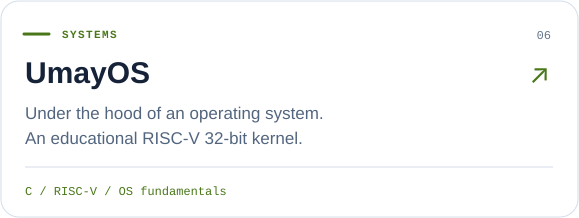
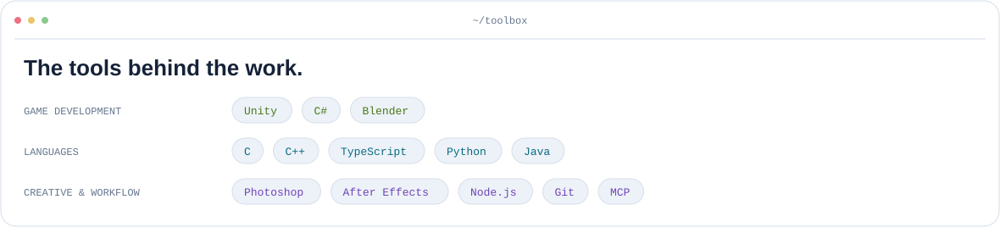

<picture>
  <source media="(prefers-color-scheme: dark)" srcset="assets/hero-dark.svg">
  <source media="(prefers-color-scheme: light)" srcset="assets/hero-light.svg">
  
</picture>

  <a href="https://emirhandoygun.vercel.app">Portfolio ↗</a> &nbsp; · &nbsp; <a href="https://www.linkedin.com/in/remirdy/">LinkedIn ↗</a> &nbsp; · &nbsp; <a href="https://github.com/Remirdy?tab=repositories">Repositories ↗</a>

<picture>
  <source media="(prefers-color-scheme: dark)" srcset="assets/about-dark.svg">
  <source media="(prefers-color-scheme: light)" srcset="assets/about-light.svg">
  
</picture>

<picture>
  <source media="(prefers-color-scheme: dark)" srcset="assets/work-dark.svg">
  <source media="(prefers-color-scheme: light)" srcset="assets/work-light.svg">
  
</picture>

<table>
<tr>
<td width="50%" valign="top">
<a href="https://apps.apple.com/tr/app/dirty-birdy/id6747272308">
<picture>
  <source media="(prefers-color-scheme: dark)" srcset="assets/dirty-birdy-dark.svg">
  <source media="(prefers-color-scheme: light)" srcset="assets/dirty-birdy-light.svg">
  
</picture>
</a>

<a href="https://apps.apple.com/tr/app/dirty-birdy/id6747272308">App Store ↗</a> &nbsp; · &nbsp; <a href="https://play.google.com/store/apps/details?id=com.moonlight.dirtybirdy">Google Play ↗</a>

</td>
<td width="50%" valign="top">
<a href="https://apps.apple.com/tr/app/juggle-trap-laser-dodge/id6760250230">
<picture>
  <source media="(prefers-color-scheme: dark)" srcset="assets/juggle-trap-dark.svg">
  <source media="(prefers-color-scheme: light)" srcset="assets/juggle-trap-light.svg">
  
</picture>
</a>

<a href="https://apps.apple.com/tr/app/juggle-trap-laser-dodge/id6760250230">App Store ↗</a> &nbsp; · &nbsp; <a href="https://play.google.com/store/apps/details?id=com.zargaslabs.juggletrap">Google Play ↗</a>

</td>
</tr>
<tr>
<td width="50%" valign="top">
<a href="https://github.com/Remirdy/PhotoshopMCP">
<picture>
  <source media="(prefers-color-scheme: dark)" srcset="assets/photoshop-dark.svg">
  <source media="(prefers-color-scheme: light)" srcset="assets/photoshop-light.svg">
  
</picture>
</a>
</td>
<td width="50%" valign="top">
<a href="https://github.com/Remirdy/BlenderMCP">
<picture>
  <source media="(prefers-color-scheme: dark)" srcset="assets/blender-dark.svg">
  <source media="(prefers-color-scheme: light)" srcset="assets/blender-light.svg">
  
</picture>
</a>
</td>
</tr>
<tr>
<td width="50%" valign="top">
<a href="https://github.com/Remirdy/AfterEffectsMCP">
<picture>
  <source media="(prefers-color-scheme: dark)" srcset="assets/motionpilot-dark.svg">
  <source media="(prefers-color-scheme: light)" srcset="assets/motionpilot-light.svg">
  
</picture>
</a>
</td>
<td width="50%" valign="top">
<a href="https://github.com/Remirdy/UmayOS">
<picture>
  <source media="(prefers-color-scheme: dark)" srcset="assets/umayos-dark.svg">
  <source media="(prefers-color-scheme: light)" srcset="assets/umayos-light.svg">
  
</picture>
</a>
</td>
</tr>
</table>

<picture>
  <source media="(prefers-color-scheme: dark)" srcset="assets/toolbox-dark.svg">
  <source media="(prefers-color-scheme: light)" srcset="assets/toolbox-light.svg">
  
</picture>

Building with curiosity, from the first frame to the last byte.

